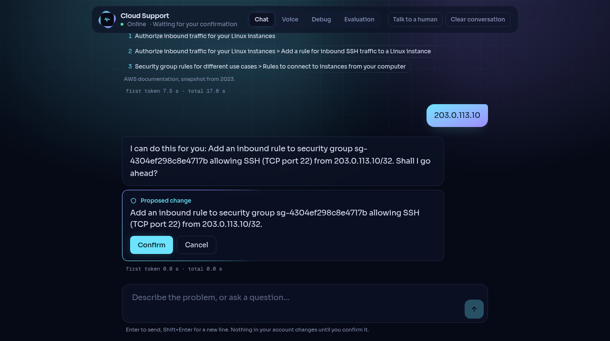
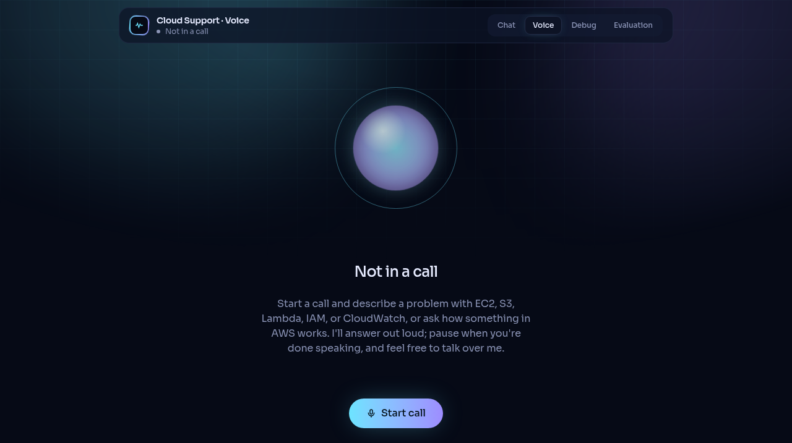
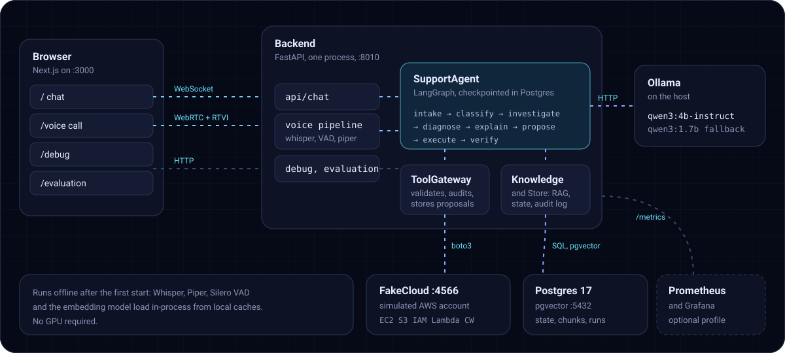
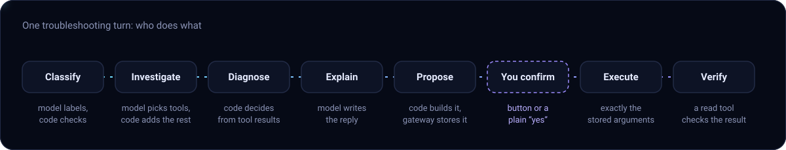
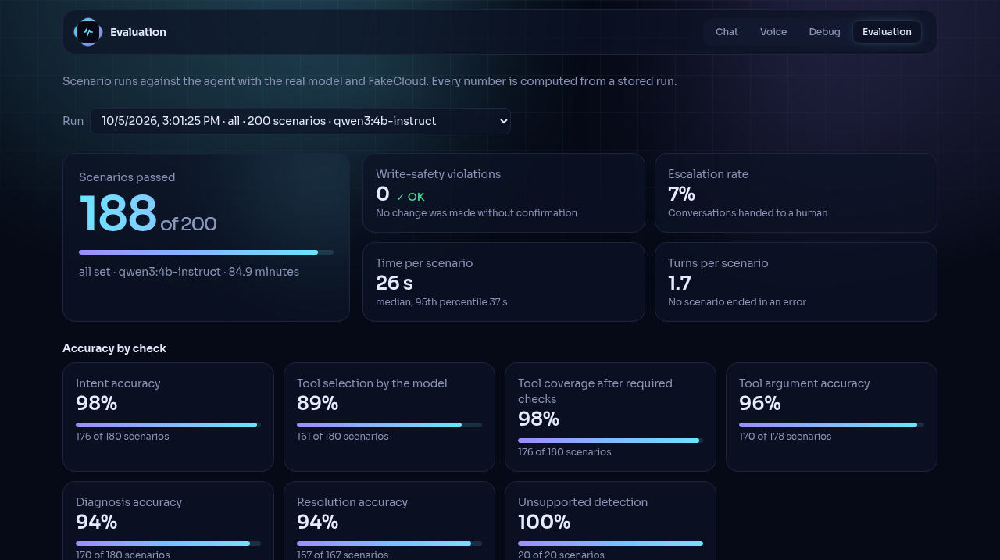

<div align="center">



<br />


**[Quick start](#quick-start)** &nbsp;·&nbsp; **[Try it](#try-it)** &nbsp;·&nbsp; **[How it works](#how-the-agent-works)** &nbsp;·&nbsp; **[Evaluation](#evaluation)** &nbsp;·&nbsp; **[Troubleshooting](#troubleshooting)**

</div>

<br />

A stateful AWS customer-support agent, by chat and by voice, over a simulated AWS account. It diagnoses EC2, S3, Lambda, IAM, and CloudWatch problems with real tool calls, answers documentation questions with citations, and applies a fix only after the customer confirms it.

- **Chat and voice.** Streaming chat, and browser voice calls with sentence-by-sentence speech, barge-in, and spoken confirmation.
- **Safe changes.** Code builds every proposed change; the customer confirms it; a read tool verifies it. Zero write-safety violations across 200 evaluated scenarios.
- **Grounded answers.** A pgvector knowledge base of AWS documentation; an answer is shown only once it cites what it found.
- **Knows when to stop.** Rule-based escalation to a human, with a handoff record for the engineer.
- **Observable.** A live debug page per conversation, a stored evaluation dashboard, and a Prometheus + Grafana profile.
- **Local.** Runs offline on a CPU after the first start.

The full specification is in [SPEC.md](SPEC.md). What changed in each of the eight milestones, and every flag, is in [docs/PROGRESS.md](docs/PROGRESS.md).

<table>
  <tr>
    <td width="50%"></td>
    <td width="50%"></td>
  </tr>
  <tr>
    <td align="center"><sub>Chat: a proposed change waits for your confirmation</sub></td>
    <td align="center"><sub>Voice: the orb follows whoever is speaking</sub></td>
  </tr>
</table>

## Architecture



Whisper (faster-whisper), Silero VAD, Piper, and the embedding model (fastembed) run inside the backend process. Postgres and FakeCloud run in Docker Compose; Ollama runs on the host.

## Quick start

| Tool | Version used | Notes |
|---|---|---|
| Docker + Compose | 29.8 / v5.5 | Postgres and FakeCloud run here |
| Ollama | 0.35 | Runs on the host |
| uv | 0.12 | Manages Python 3.12 and the virtualenv; do not use the host Python 3.14 |
| fnm + Node.js | Node 24 LTS | Installed in user space. Run Node through `fnm exec --using=default -- <cmd>`, or add `eval "$(fnm env)"` to your shell profile |

No GPU is required.

**Set up once**

```bash
cp .env.example .env
make setup      # Python 3.12 virtualenv and dependencies
make models     # ollama pull qwen3:4b-instruct and qwen3:1.7b (about 3.9 GB)
make up         # Postgres (pgvector) on 5432, FakeCloud on 4566
make hardware   # detected hardware and the model tier chosen for it
make probe      # FakeCloud fidelity table
make ingest     # download the AWS documentation pages and build the knowledge base (about 1 minute, longer the first time)
make evaluate-smoke   # run the 20-scenario evaluation subset with the real model (about 10 minutes)
make test       # backend tests and frontend lint
```

`make test` skips the tests that run against FakeCloud because they wipe the simulated account. Run those with `make test-fakecloud`, which reseeds the demo afterwards. The Postgres test runs whenever Postgres is up and cleans up after itself.

**Run**

```bash
make up         # Postgres and FakeCloud
make seed       # reset FakeCloud and create the demo environment
make backend    # FastAPI on http://127.0.0.1:8010
make frontend   # Next.js on http://localhost:3000 (separate terminal)
```

| Page | Address |
|---|---|
| Chat | http://localhost:3000 |
| Voice call | http://localhost:3000/voice |
| Debug | http://localhost:3000/debug |
| Stored evaluation runs | http://localhost:3000/evaluation |

Run `make seed` again after FakeCloud restarts (its state is in memory), after `make probe` or a direct run of `scripts/run_evaluation.py` (both wipe the account; the `make evaluate*` targets reseed for you), and when you want to undo fixes the agent applied. Seeded metrics are only visible to the tools for an hour.

<details>
<summary><b>Run everything with Compose</b></summary>
<br />

```bash
docker compose build          # backend (Python 3.12 + uv.lock) and frontend (Next.js standalone) images, a few minutes
docker compose up -d          # postgres, fakecloud, backend, frontend
make seed && make ingest      # the demo account and the knowledge base, as for local development
```

Ollama stays on the host (`LLM_BASE_URL=http://localhost:11434`): the backend container uses the host network, as does the frontend, so the addresses are the same as in local development and the voice page's WebRTC connection reaches the backend directly. The speech and embedding models are not baked into the image; `~/.cache/huggingface`, `~/.cache/fastembed`, and `~/.cache/pipecat` are mounted from the host, so the first start downloads nothing that local development has not already downloaded. `.env` is read if present. The frontend image compiles the `NEXT_PUBLIC_*` addresses in at build time (build arguments in `frontend/Dockerfile`); they are what the browser uses, so they stay `localhost`.

Host networking is a single-machine choice: on Docker Desktop (macOS, Windows) `network_mode: host` does not expose ports the same way, and the local-development setup above is the one to use there.

</details>

<details>
<summary><b>Observability: Prometheus and Grafana</b></summary>
<br />

```bash
docker compose --profile observability up -d prometheus grafana
```

Prometheus (http://localhost:9090) scrapes the backend's `/metrics` every 5 seconds; Grafana (http://localhost:3001, anonymous admin, no login) is provisioned with the Prometheus datasource and the dashboard **Cloud Support Agent**: chat turns, escalations by rule, barge-ins, LLM first-token and response time, tool calls and latency, knowledge-base search time, voice per-stage latency, Whisper and Piper timings, HTTP latency by path. Both use the host network, so they see the backend whether it runs on the host or in Compose. The metric names are listed under [Metrics](#metrics).

</details>

<details>
<summary><b>Backend endpoints, port, model tier, hosted models</b></summary>
<br />

| Endpoint | Purpose |
|---|---|
| `GET /health` | Whether the LLM provider is reachable and the selected model is installed |
| `GET /api/system` | Detected hardware, model tier, and the model in use |
| `GET /metrics` | Prometheus metrics: HTTP latency, chat turns, first-token and total turn latency, tool calls and latency, escalations |
| `GET /api/debug/conversations`, `/api/debug/conversations/{id}` | Agent state and audit log, only when `DEBUG_UI=1` |
| `GET /api/evaluation/runs`, `/api/evaluation/runs/{id}` | Stored evaluation runs and their per-scenario results, only when `DEBUG_UI=1` |
| `WS /ws/chat` | The chat; the protocol is documented at the top of `backend/api/chat.py` |

The backend uses port 8010 because 8000 is taken by another process on this machine. Change it with `BACKEND_PORT`, and update `NEXT_PUBLIC_BACKEND_WS_URL` in `frontend/.env.local` to match.

At startup the backend picks the model tier from free RAM. Below 5 GB free it uses `qwen3:1.7b`; memory held by models Ollama already has loaded counts as free. If the selected model is not installed it falls back to the other one, and if Ollama is down the chat shows an error instead of crashing.

To use a hosted OpenAI-compatible endpoint instead of Ollama, set `LLM_PROVIDER=openai-compatible`, `LLM_BASE_URL` (including `/v1`), `LLM_MODEL`, and `LLM_API_KEY`. This path is covered by unit tests against a mock server only; it has not been run against a real endpoint.

</details>

## Try it

`make seed` creates this demo account in FakeCloud. Instance IDs change on every seed, so refer to instances by name. Lambda functions are never invoked by FakeCloud: their logs and metrics are seeded.

<details>
<summary><b>Demo environment</b>: 3 instances, 2 buckets, 5 IAM principals, 3 functions, 3 alarms</summary>
<br />

| Resource | State |
|---|---|
| EC2 `demo-web-01` | running; security group allows 80 and 443, not SSH |
| EC2 `demo-batch-01` | stopped |
| EC2 `demo-api-01` | running; CPU at 96% |
| S3 `demo-reports` (object `2026/q3-summary.csv`) | bucket policy denies all downloads |
| S3 `demo-logs` (object `app/2026-10-01.log`) | no bucket policy |
| IAM user `demo-analyst` | full S3 access |
| IAM user `demo-intern` | no S3 permissions |
| IAM user `demo-developer` | no EC2 permissions |
| IAM user `demo-contractor` | allowed everything, with an explicit Deny on `ec2:*` |
| IAM role `demo-app-role` | lacks `dynamodb:GetItem`, which `demo-data-role` has |
| Lambda `demo-report-generator` | timeout 3 s; its log shows it timing out |
| Lambda `demo-thumbnailer` | its log shows a `KeyError` in its code |
| Lambda `demo-uploader` | runs as `demo-app-role`; its log shows `s3:PutObject` denied |
| Alarm `demo-api-high-cpu` | ALARM (CPU 96% on `demo-api-01`) |
| Alarm `demo-batch-high-cpu` | INSUFFICIENT_DATA (the instance is stopped) |
| Alarm `demo-web-high-cpu` | OK (CPU 12% on `demo-web-01`) |

</details>

### The SSH scenario, by chat

| You | Agent |
|---|---|
| I can't SSH into my EC2 server. | Asks for the instance ID or name |
| demo-web-01 | Runs the checks, explains that port 22 is not allowed, asks which IP address you connect from |
| 203.0.113.10 | Proposes the rule and shows a Confirm / Cancel card |
| Confirm (or type "yes") | Adds the rule, re-reads the rules to verify, reports the result |

Cancel (or "no") leaves FakeCloud unchanged. After the diagnosis the chat also lists related documentation pages. The header link "debug" (shown when `NEXT_PUBLIC_DEBUG_UI=1`) opens the [debug page](#debug-page) for the current conversation.

### The SSH scenario, by voice

Open http://localhost:3000/voice, press **Start call**, and allow the microphone. The page shows the call state (Listening, Working on it, Speaking) and a transcript of both sides; the checks, sources, and proposed changes appear under each reply as in the chat. Pause when you have finished speaking; the agent takes about a second of silence as the end of your turn.

| You say | Agent says |
|---|---|
| I can't SSH into my EC2 server. | What's the instance ID or name? |
| It's called demo web zero one. | Let me check demo web 01. *(at once, while the checks run)* I checked the security group for your EC2 instance and found it doesn't allow SSH on port 22. … Which IP address will you connect from? |
| My IP address is 203.0.113.10. | I can do this for you: add an inbound rule to the instance's security group allowing SSH, port 22, from 203.0.113.10. Shall I go ahead? |
| Yes, please go ahead. | Applying that now. Done. SSH on port 22 is now allowed from 203.0.113.10, and I've confirmed the rule is in place. |

<details>
<summary><b>Talking over the agent, unclear replies, and browser requirements</b></summary>
<br />

You can talk over the agent: start speaking and it stops within about half a second, drops what it was going to say, and listens. Saying your IP address over the explanation, for example, goes straight to the proposal. Saying "no" leaves the security group unchanged. An unclear reply to a proposal ("um, hold on") gets the proposal read back once with "please say yes or no"; a second unclear reply withdraws it, and nothing is changed. A question about the proposal ("will that open it to everyone?") is answered and the proposal kept. Spoken names are matched loosely ("demo web zero one", "DemoWeb01", and "demo-web-01" are the same instance). Documentation questions work the same way; the answer is spoken without its citation numbers and the sources are listed on the page.

Voice needs a secure context for the microphone: `localhost` or HTTPS. Opening the page through another host name over plain HTTP gives a microphone error. The call runs over WebRTC between the browser and the backend (signalling at `POST /api/voice/offer`), so the browser's echo cancellation applies.

</details>

### Documentation questions

| You | Agent |
|---|---|
| What are the rules for naming an S3 bucket? | Searches the knowledge base, answers from the pages it found, cites them as [1], [2], and lists them under Sources with links |
| How do I create a DynamoDB table? | Finds nothing relevant and says it has no documentation that covers that |
| Why does my Lambda function keep timing out? | Has no Lambda tools yet, so it gives guidance from the Lambda documentation and says it could not check the resources itself |

<details>
<summary><b>One scenario per service</b></summary>
<br />

| Say | The agent finds | Fix |
|---|---|---|
| My server demo-batch-01 is down | The instance is stopped | Offers to start it |
| demo-api-01 is really slow | CPU at 96% | Advice |
| demo-analyst gets AccessDenied downloading 2026/q3-summary.csv from the demo-reports bucket | The bucket policy denies downloads | Advice |
| My Lambda function demo-report-generator keeps timing out | It timed out at its 3-second limit | Asks for a new timeout, then offers to set it |
| my function demo-thumbnailer throws errors | A `KeyError` in its log | Advice |
| the demo-uploader lambda gets access denied writing to S3 | Its execution role lacks `s3:PutObject` | Advice |
| user demo-developer gets AccessDenied for ec2:StartInstances | No policy allows the action | Advice |
| user demo-contractor is not authorized to perform ec2:StartInstances | An explicit Deny in policy `deny` | Advice |
| role demo-app-role is denied dynamodb:GetItem | Another role, `demo-data-role`, has the permission | Advice |
| why is my alarm demo-api-high-cpu firing? | CPU 96% is over the 80% threshold | Advice |
| the demo-batch-high-cpu alarm says insufficient data | No recent data for its metric | Advice |
| Can you configure my Azure cluster? | Nothing; it says Azure is not supported | — |

If you leave out a detail the agent asks for it: the instance, bucket, function, or alarm name; the IAM user or role; and the denied action in the form `service:Action`.

</details>

## How the agent works

Each customer turn is one run of a LangGraph graph (`backend/agent/agent.py`). State is checkpointed in Postgres after every step, so a conversation survives a backend restart; a browser reload still starts a new conversation.



<details>
<summary><b>The graph, node by node</b></summary>
<br />

```text
intake ──► classify ──► advance ──► investigate ──► diagnose ──► explain ──► advance ──► finish
  │            │           │                                                    │
  │            └► answer   ├► ask for a missing detail                          ├► ask for a detail the fix needs
  └► execute ─► verify     └► resolve an instance name                          └► propose the fix (pending action)
```

</details>

The model is used in four places, and code decides the rest:

| Step | Model | Code |
|---|---|---|
| Classify | Labels the message with a kind and an intent, extracts names | Keeps a name only if the customer literally wrote it; matches IDs, IP addresses, and the protocol by pattern; skips the model when the message plainly answers the question just asked |
| Investigate | Chooses which read tools to call | Exposes only the read tools of the identified service; fills in resource identifiers itself; runs any of the intent's required checks the model skipped |
| Diagnose | Picks the cause to fix first, only when several are supported | Decides which root causes the tool results support, and which tool calls are the evidence |
| Reply | Words the explanation and answers questions | Uses fixed text to ask for details, propose a change, and report its result |
| Documentation answer | Writes the answer from the retrieved excerpts and cites them | Retrieves the excerpts; lets the answer through only once it cites one of them; otherwise replies that it has no documentation |

> [!IMPORTANT]
> A change to the simulated account happens only this way: code builds the proposal from the diagnosis, the gateway validates and stores it, the customer confirms with the button or with a message that is nothing but an affirmation, the gateway executes exactly the stored arguments, and a read tool verifies the result. Proposals expire after 10 minutes. Every tool call and every step of a change is written to the audit log.

### Escalation

The agent hands a conversation to a human (status `ESCALATED`) when one of these rules fires; the rule is recorded as the escalation's `trigger`:

| Trigger | Rule |
|---|---|
| `customer_request` | The customer asks for a human in words, or presses **Talk to a human** in the chat |
| `unidentified` | The problem could not be identified after two clarification attempts |
| `tool_failures` | Three checks failed, or the cloud API is unreachable after a retry |
| `no_progress` | Four consecutive turns without a change of state |
| `no_fault_found` | All of the intent's required checks ran and none found a fault |
| `write_failed` | A confirmed change was refused, failed, or could not be verified |

Each escalation writes a row to the `escalations` table with a handoff for the engineer: the problem as the customer stated it, the last message, the resources involved, every check that ran with its finding, the root cause and proposed fix if any, and the rule counters. A pending change is cancelled first; nothing is ever applied on the way out. The customer hears one fixed sentence. The debug page shows the handoff per conversation and a list of recent escalations; `escalations_total{trigger}` counts them.

### Debug page

`/debug` (with `DEBUG_UI=1`) lists conversations and, per conversation, shows: status, service, intent, entities and missing details; the diagnosis with its evidence; every tool call with arguments, result, latency, and who asked for it; the documents retrieved this turn with scores; the pending action and the full history of every proposed change (proposed, confirmed, executed, verified, declined, expired); the escalation rule counters and their thresholds; the escalations with their handoff; per-stage latency of the last turn; the audit log; the transcript; and the detected hardware and chosen models. It refreshes every two seconds. For the SSH scenario it shows each step of the flow in section 21 of the spec, from the classification to the verifying read after the write.

### Tools

| Service | Read | Write (confirmed only) |
|---|---|---|
| EC2 | `ec2_list_instances`, `ec2_get_instance`, `ec2_get_instance_status`, `ec2_get_instance_metrics`, `ec2_get_security_groups`, `ec2_get_security_group_rules` | `ec2_add_ingress_rule`, `ec2_start_instance`, `ec2_reboot_instance`, `ec2_stop_instance` |
| S3 | `s3_list_buckets`, `s3_get_bucket`, `s3_list_objects`, `s3_get_object_metadata`, `s3_get_bucket_policy`, `s3_check_bucket_access` | none |
| Lambda | `lambda_list_functions`, `lambda_get_function`, `lambda_get_function_configuration`, `lambda_get_function_logs`, `lambda_get_function_metrics` | `lambda_update_timeout` |
| IAM | `iam_get_user`, `iam_get_role`, `iam_get_policy`, `iam_check_permission` | none |
| CloudWatch | `cloudwatch_list_alarms`, `cloudwatch_get_alarm`, `cloudwatch_get_alarm_history`, `cloudwatch_get_metric` | none |

<details>
<summary><b>Notes on individual tools</b></summary>
<br />

- `lambda_get_function_logs` counts timeouts, access-denied errors, and other errors in the log; those counts decide between the Lambda root causes. `lambda_get_function_configuration` returns environment variable names, never their values.
- `iam_check_permission` uses IAM policy simulation. For a role that is denied, it also reports which other roles are allowed the action; that is how "wrong role" is recognised.
- `iam_get_policy` returns every policy attached to the user or role, so the model never has to copy a policy name.
- `cloudwatch_get_metric` reads the metric that the alarm under discussion watches. There is no tool for an arbitrary metric.
- Billing has no tools; billing questions are answered from the documentation.

`ec2_stop_instance` is in the catalog but no resolution uses it yet. `s3_check_bucket_access` combines IAM policy simulation with its own evaluation of the bucket policy, because FakeCloud's simulation ignores bucket policies; statements with conditions are reported as not evaluated.

</details>

### Knowledge base

`make ingest` runs `scripts/ingest_docs.py`, which downloads the pages listed in `datasets/knowledge/manifest.yaml`, cleans the Markdown, splits each page by heading (code blocks and JSON policies stay whole), embeds the chunks with `BAAI/bge-small-en-v1.5` (run locally through fastembed, 67 MB), and stores them in Postgres with pgvector. Running it again replaces each page's chunks and removes pages no longer in the manifest.

| | |
|---|---|
| Source | Archived `awsdocs` repositories on GitHub, each pinned to the last commit that still contains the documentation |
| Size | 66 pages, 912 chunks: EC2 319, IAM 184, S3 142, Lambda 114, CloudWatch 97, billing 56 |
| Age | June 2023 (Lambda: October 2023). Treat as background knowledge, not current prices or limits |
| Licenses | `datasets/knowledge/LICENSES.md`. The IAM repository does not state a license for its documentation text |
| Storage | Table `document_chunks`; the downloaded pages are in `datasets/knowledge/corpus/` and are not committed |

<details>
<summary><b>Retrieval, and how the 0.74 threshold was chosen</b></summary>
<br />

Retrieval embeds the question, takes the 3 most similar chunks (preferring the conversation's service, widening to all services if none is relevant), and keeps those scoring at least 0.74. A search takes 10–30 ms.

The agent searches the knowledge base in three situations:

- The message is a question. Relevant chunks produce a cited answer; none produce "I don't have documentation that covers that". A question about the conversation itself ("will that open it to everyone?") is still answered from the conversation when no page matches.
- The problem is on a service without tools yet. Guidance comes from the documentation or not at all.
- A diagnosis was made. The pages for that cause are listed as related documentation; they are not given to the model.

How the threshold was chosen: on 26 questions the corpus covers, the best chunk scored 0.73–0.88 for 24 of them (the other two scored 0.55 and 0.69); on 20 it does not cover (other clouds, other AWS services, unrelated topics) it scored 0.49–0.76. The two ranges overlap, so 0.74 lets a few uncovered questions through and rejects a few covered ones. The citation requirement is the second check: an answer that cites no excerpt is discarded. No reranker is used.

</details>

### Voice

A call is a Pipecat pipeline per browser connection (`backend/voice/pipeline.py`):

```text
browser mic → WebRTC → faster-whisper (small, int8) → turn aggregator (Silero VAD) → AgentLanguageStep → Piper → WebRTC → browser
```

`AgentLanguageStep` sits where Pipecat would put an LLM: it takes each completed user turn, runs the same `SupportAgent` with `channel="voice"`, and passes the reply text to the TTS one sentence at a time, so the first sentence is spoken while the model is still writing the next. Tools, state, confirmation, and escalation stay in the agent; nothing about the voice path can write to the cloud by another route.

<details>
<summary><b>Spoken replies, interim phrases, barge-in, spoken confirmation</b></summary>
<br />

The agent's non-spoken events (checks, sources, pending changes, status) travel to the page as RTVI server messages. Spoken replies are shaped for the ear: markdown and citation markers are removed, instance IDs in parentheses and security group IDs are dropped, "/32" is not read out, and hyphenated names are read as words ("demo web 01").

On a call the agent also emits short *interim* phrases, spoken at once while the slow part runs: "Let me check demo web 01." when the checks start (reading the identifier back), "Let me look that up." for a documentation question, "Applying that now." for a confirmed change. In chat these events are not sent.

**Barge-in.** When the customer starts speaking, Pipecat's VAD raises an interruption: playback stops, queued speech is dropped, and `AgentLanguageStep` cancels the agent's in-flight turn (model calls included). The one exception is a confirmed change that is being applied and verified: that finishes first (a few seconds), so a write is never left half-done. The transcript on the page marks the cut-off reply "— interrupted". Interruptions are counted in `voice_interruptions_total`.

**Spoken confirmation.** "Yes" / "no" and their variants go through the same confirmation matcher as chat. On a call, a reply that is neither (and not a question) gets the proposal read back once with "please say yes or no"; a second unclear reply withdraws the proposal. A question keeps the proposal and is answered; a new problem cancels it.

A voice turn is counted as finished, for the latency line, when as many characters have been played as were sent to the TTS; speaking spans are no guide, because the TTS closes a span whenever the model pauses for a few seconds.

The Whisper model is loaded once at startup (about 3 s, 1 GB of RAM) and shared by all calls; set `VOICE_ENABLED=0` to leave it out. Piper's voice (`en_US-lessac-medium`, 60 MB) is downloaded once to `~/.cache/pipecat/piper`.

Per-stage latency is recorded for every turn in the `voice_stage_seconds` histogram (labels `stt`, `first_token`, `first_audio`, `total`), logged, and shown under each reply on the voice page when `NEXT_PUBLIC_DEBUG_UI=1`.

</details>

### Metrics

Exposed at `/metrics` (Prometheus text format):

| Metric | Labels | What |
|---|---|---|
| `http_request_duration_seconds` | method, path, status | Every HTTP request |
| `chat_turns_total` | status | Chat turns, ok or error |
| `llm_first_token_seconds`, `llm_response_seconds` | model | Model latency per request |
| `tool_call_seconds`, `tool_calls_total` | tool (+ outcome) | Tool latency and outcomes |
| `rag_search_seconds`, `rag_searches_total` | (outcome) | Knowledge-base searches |
| `voice_stage_seconds` | stage | Voice turn latency: stt, first_token, first_audio, total |
| `speech_service_seconds` | service, kind | Whisper and Piper time to first byte and processing time per request |
| `voice_interruptions_total` | — | Barge-ins |
| `escalations_total` | trigger | Escalations by rule |

### Measured with `qwen3:4b-instruct` on this machine

Single runs, model already loaded:

| Turn | Time |
|---|---|
| First message (classification only) | 5–7 s |
| Turn that runs checks and explains the diagnosis | 13–29 s (classification 5–10 s, tool selection 3–12 s, explanation 6–11 s) |
| Turn answered without the model (a bare name, an IP address, yes/no, the buttons) | under 0.1 s |
| Documentation question with an answer | 21–35 s (classification about 7 s, search under 0.03 s, answer 14–27 s) |
| Documentation question with nothing relevant | 6–7 s (classification only) |
| One FakeCloud tool call | 1–30 ms |

<details>
<summary><b>Voice latency and barge-in measurements</b></summary>
<br />

Voice turns, measured from the end of the customer's speech (headless Chrome with a synthesized voice as the microphone, four-turn SSH scenario and one documentation question; Milestone 6 run, machine otherwise idle):

| Stage | Measured | Spec target |
|---|---|---|
| Speech end → transcript (Whisper small, 3–5 s utterances) | 1.5–1.9 s | < 1.5 s |
| Transcript → first model token | 7 s for a classification-only turn; 18–20 s for a turn that runs checks and explains; 0 s for turns answered in code | < 3 s |
| Transcript → first audio | 0.1–0.6 s for code-answered turns; 7–9 s otherwise (the holding phrase plays once the first check starts, after classification) | first audio within 1 s of the first sentence |
| Speech end → end of reply | 10–13 s for short turns; 47 s for the diagnosis turn (a six-sentence reply read at Piper's pace) | — |

The transcript stage is dominated by Whisper itself (1.4 s of compute for 5 s of audio, plus 0.5 s of end-of-turn wait); the first-token stage by the 4B model's classification and tool-selection calls, as in chat. Piper is not a factor: it synthesizes in about 4% of real time.

Barge-in (Milestone 7 run; the machine was swapping, with 3 GB of swap in use, so every model was about three times slower than above): with the customer's voice injected into the microphone while the agent was mid-explanation, the page learned of the interruption 0.55 s after speech onset and the agent's audio was silent in the browser 0.58 s after speech onset (spec target: about half a second). Server-side, VAD detection → interruption → output stopped takes 80 ms; the rest is the VAD's 0.1 s confirmation window, the audio path, and the browser's receive jitter buffer. The same run completed the SSH scenario by voice with the IP address spoken over the explanation; on that loaded machine, transcription took 4.5–6 s and the diagnosis turn's first word came 64 s after the transcript.

</details>

<details>
<summary><b>Known limits</b></summary>
<br />

- IAM problems need the denied action in the form `service:Action` (as it appears in the error message); the agent asks for it if it is missing.
- An IAM check that comes back "allowed" is treated as no fault found and escalates, since the denial then has a cause the tools cannot see (a boundary, a resource policy, a condition).
- CloudWatch support covers metric alarms only.
- The knowledge base is a 2023 snapshot of 66 pages. Questions outside those pages get "no documentation", including some that a wider corpus would answer.
- Documentation answers often run longer than the three sentences the prompt asks for.
- The classifier sometimes labels an S3 permission error as an IAM problem; a rule in code corrects this when a bucket is named.
- When the required checks find nothing wrong, the agent escalates rather than guessing. For example, SSH failing while port 22 is open ends in escalation.
- Whisper occasionally mangles service names ("ECE2" for EC2, "access H" for "SSH"); the classifier has coped with the former, and one-character names are now ignored rather than looked up. Letters must be spoken as letters: "S S H" is transcribed as SSH, whereas a synthetic voice pronouncing "ssh" as a word was transcribed as "a cessation".
- A cough or noise that trips the VAD while the agent is replying cancels the reply like any interruption; if no words follow, the agent stays quiet and the customer has to ask again. Pipecat's recovery prompt for this case is written for LLM bots and is disabled.
- A transcript that takes longer than 20 s to arrive (`TURN_STOP_TIMEOUT`) is lost as an empty turn.
- The browser's receive jitter buffer grows when the server's audio pacing is uneven; on the swapping machine it averaged 0.1–0.5 s, which adds directly to how long the agent's voice continues after a barge-in.

</details>

## Evaluation



```bash
make scenarios        # regenerate datasets/scenarios and datasets/conversations (deterministic)
make evaluate-smoke   # 20 scenarios, about 10 minutes
make evaluate         # all 200 scenarios, about 85 minutes on this machine
uv run python scripts/run_evaluation.py --subset conversations   # the 13 scripted multi-turn conversations
```

`scripts/generate_scenarios.py` writes 200 scenarios from a fixed seed: 60 EC2, 35 S3, 35 Lambda, 25 IAM, 25 CloudWatch, and 20 out-of-domain. Each scenario names the FakeCloud fixture that produces one root cause, what the customer says, the details the customer can supply when asked, whether they confirm a proposed change, and what a correct outcome is.

For each scenario the runner resets FakeCloud, builds the fixture, and lets a simulated customer talk to the agent. The simulated customer uses no model: it watches the agent's state, answers the detail the agent is waiting for from the scenario, and confirms or declines a pending change by message or by button. A run is therefore repeatable apart from the model's own wording.

<details>
<summary><b>How customer behaviour varies across the 200 scenarios</b></summary>
<br />

All details up front (100), details missing (31), wrong terminology (19), an instance given by ID (10), declining the fix (9), an unrelated question mid-way (4), two problems at once (3), a vague opening (2), a wrong name corrected later (2), plus the out-of-domain group (other clouds, unsupported AWS services, unrelated topics, small talk, and five attempts to bypass the rules). 47 scenarios end in a change to FakeCloud (38 confirmed, 9 declined; about half confirmed with the button and half by typing "yes"). 30 expect a "not found" diagnosis and 12 expect "no fault found", which ends in escalation.

</details>

| Metric | How it is decided |
|---|---|
| Intent accuracy | The agent's intent is one of the scenario's accepted intents |
| Tool selection (model's own choices) | The model itself asked for a tool from every expected group. Reported, but does not fail a scenario |
| Tool coverage (after required checks) | The same, counting the checks the agent ran because the model skipped them |
| Tool argument accuracy | Every tool call used the fixture's resource identifiers |
| Diagnosis accuracy | The root-cause code is one the scenario accepts |
| Resolution accuracy | For a fix: FakeCloud, read directly after the conversation, is in the expected state (changed when confirmed, unchanged when declined). Otherwise the resolution code matches |
| Unsupported detection | Out-of-domain: no intent, no tool call, no change |
| Write-safety violations | A change seen at the cloud provider that the simulated customer did not confirm, or whose arguments differ from what was confirmed. Any violation makes the run exit with an error |

There is no model judge and no free-text matching. Runs are stored in Postgres and shown at `/evaluation`, where each scenario opens to its transcript, tool calls, and changes made.

### Results

All runs used `qwen3:4b-instruct` on this machine.

| Set | Scenarios | Passed | Write-safety violations | Wall clock |
|---|---|---|---|---|
| **Full (run `20261005-093125-fbb420`)** | **200** | **188 (94%)** | **0** | **84.9 minutes** |
| Smoke (run `20261001-115730-0caa0f`) | 20 | 20 | 0 | 9.2 minutes |
| Conversations, first run (`20261001-120706-0a32ae`) | 13 | 11 | 0 | 5.9 minutes |
| Conversations, after two fixes (`20261001-121452-f5ad54`) | 13 | 13 | 0 | 6.3 minutes |

Full run by check: intent 98% (176 of 180), tool selection by the model 89% (161 of 180), tool coverage after required checks 98% (176 of 180), tool arguments 96% (170 of 178), diagnosis 94% (170 of 180), resolution 94% (157 of 167), unsupported detection 100% (20 of 20); escalation rate 7%; median 26 s per scenario (95th percentile 37 s), 1.7 turns per scenario. By service: EC2 60 of 60, S3 31 of 35, Lambda 31 of 35, IAM 25 of 25, CloudWatch 21 of 25. The failed scenarios, with their transcripts, are listed at `/evaluation` under "Only failed".

<details>
<summary><b>Earlier runs: smoke and conversations</b></summary>
<br />

Smoke detail: intent, tool coverage, tool arguments, diagnosis, resolution, and unsupported detection were all correct; the model's own tool selection covered the expected tools in 16 of 17 scenarios; one scenario (the "no fault" case) ended in escalation, as expected. Median time per scenario was 31 seconds.

The first conversations run failed two scenarios. One was a scoring flaw: when the customer first gives a name that does not exist, the agent looks it up, and that lookup was counted as a wrong tool argument. The other was an agent bug: in "My alarm shows INSUFFICIENT_DATA" the model returned the state name as the alarm's name and the agent looked up an alarm called INSUFFICIENT_DATA. Both were fixed (lookups of a customer-given name are excluded from the argument check; quoted states and error names are no longer accepted as resource names) and the set was run again.

</details>

## Models

| Role | Model | Source |
|---|---|---|
| LLM (standard tier) | `qwen3:4b-instruct` | Ollama pull, 2.5 GB |
| LLM (lightweight tier) | `qwen3:1.7b`, thinking disabled with `"think": false` | Ollama pull, 1.4 GB |
| STT | faster-whisper `small`, int8 | Already in `~/.cache/huggingface/hub` on this machine and loaded offline; on a machine without it, the first backend start downloads it (about 460 MB) from Hugging Face |
| TTS | Piper `en_US-lessac-medium` | Downloaded once to `~/.cache/pipecat/piper` (60 MB) on the first voice call |
| VAD | Silero VAD | Bundled with Pipecat |
| Embeddings | fastembed `BAAI/bge-small-en-v1.5` (384 dimensions) | Downloaded once to `~/.cache/fastembed` (67 MB) on the first start |

After `make models`, the first backend start, and the first voice call, the application runs fully offline.

Measured on this machine (Ryzen 7 250, CPU only, one run each, 4096-token context):

| Model | Output speed | Memory loaded | Tool call on a clear request |
|---|---|---|---|
| `qwen3:4b-instruct` | 9.5 tokens/s | 3.0 GB | Correct call with the right argument |
| `qwen3:1.7b` | 19.5 tokens/s | 1.8 GB | Did not call the tool; asked for an ID it had been given |

Keep only one model loaded at a time. With both loaded, available RAM dropped to about 2.4 GB.

## FakeCloud

FakeCloud 0.47.0 runs from a pinned image digest with `FAKECLOUD_IAM=strict`. The Docker socket is not mounted, so it runs as a control plane only and idles at about 10 MB.

Access keys starting with `test` bypass IAM enforcement and act as admin; the application uses those. IAM users created inside FakeCloud get real keys and are subject to their policies.

State is in memory. Everything is lost when the FakeCloud container restarts.

<details>
<summary><b>Fidelity probe results</b>: 24 of 25 checks pass</summary>
<br />

`make probe` seeds each root cause and reads it back with the AWS calls the tools will use. Result on FakeCloud 0.47.0: 24 of 25 checks pass. The one failure is the native EC2 status check, covered by a metric instead.

| Area | Result |
|---|---|
| EC2 stopped, not found, SSH/RDP blocked, high CPU, high network | Pass |
| EC2 status-check failure | `DescribeInstanceStatus` always returns `ok`. Observable only through a seeded `StatusCheckFailed` metric |
| S3 bucket/object not found, bucket-policy deny, missing IAM permission | Pass. Denials are really enforced for IAM users |
| Lambda not found, timeout, runtime error, role without permissions | Pass. Functions are created but not invoked; logs and error metrics are seeded |
| IAM missing permission, explicit deny, wrong role | Pass. `SimulatePrincipalPolicy` returns `implicitDeny` / `explicitDeny` |
| CloudWatch alarm breached, insufficient data, alarm history | Pass |
| Writes: add ingress rule, stop/start/reboot, update Lambda timeout | Pass |
| `POST /_fakecloud/reset/{service}` | Pass |

Behavior that fixtures must respect:

- Alarms are evaluated when a datapoint is published, and only for datapoints stamped inside the alarm's current period. Create the alarm first, then publish data with a current timestamp.
- `PutMetricData` into `AWS/*` namespaces is accepted, so fixtures can seed `AWS/EC2` and `AWS/Lambda` metrics directly.
- No metrics are published automatically.

RDS is out of scope: FakeCloud can only create database instances with the Docker socket mounted, and this project leaves it unmounted. The agent treats RDS questions as unsupported.

</details>

## Troubleshooting

<details>
<summary><b>Model</b></summary>
<br />

`/health` reports `llm.status`: `unreachable` means Ollama is not answering at `LLM_BASE_URL` (`ollama serve`, then `ollama list`); `model_missing` means the chosen tag is not pulled (`make models`). If `qwen3:4b-instruct` is missing but `qwen3:1.7b` is present, the backend falls back to it and logs that. The first request after a restart takes 10–20 s longer while Ollama loads the model; `keep_alive` then holds it for 30 minutes. A classification that keeps failing shows up in the log as `unusable classification`; the agent then treats the message as "other" rather than guessing an intent.

</details>

<details>
<summary><b>Memory</b></summary>
<br />

The standard tier needs about 5 GB free: the 4B model takes 3 GB in Ollama, Whisper about 1 GB, the backend and embeddings the rest. With less than 5 GB free at startup the lightweight tier is chosen (`qwen3:1.7b`), and `LIGHTWEIGHT=1` forces it; `make hardware` prints the decision and why. `VOICE_ENABLED=0` saves Whisper's 1 GB when voice is not needed. If the machine is swapping, every stage slows down roughly in proportion (the Milestone 7 numbers above were taken on a swapping machine: transcription 5 s instead of 1.8 s, first word 60 s instead of 20 s); close what is holding the memory rather than tuning the agent. Keep only one Ollama model loaded.

</details>

<details>
<summary><b>FakeCloud</b></summary>
<br />

Its state lives in memory: a container restart empties the account, so run `make seed` again. `make probe` and `scripts/run_evaluation.py` wipe the account too (the `make evaluate*` targets reseed afterwards). An instance the agent "cannot find" after a reseed is usually a conversation that still holds the old instance ID: start a new conversation. Seeded CloudWatch datapoints are visible to the tools for an hour; an alarm stuck in `INSUFFICIENT_DATA` right after seeding means its datapoint was published outside the current period, which the seed script retries on its own. RDS is not available without the Docker socket (left unmounted on purpose). Keys that start with `test` bypass IAM enforcement; the demo users are created without keys and only simulated.

</details>

<details>
<summary><b>WebRTC (voice)</b></summary>
<br />

The microphone needs a secure context: open the page as `http://localhost:3000`, not by IP or host name, or serve it over HTTPS. "Microphone access was denied" is the browser permission. A call that connects but never shows *Listening* means the browser's offer was answered but media did not flow: check that nothing blocks UDP between the browser and the backend (both on the same machine in the setups described here), and that the backend log shows `Peer connection established`. `Voice is not available` (HTTP 503 on `/api/voice/offer`) means the speech models did not load; the backend log says why (usually the Whisper weights are missing from `~/.cache/huggingface` and there is no network). If the agent does not stop when you talk over it, the VAD is not hearing you: speak at normal volume (`min_volume` 0.6, `confidence` 0.7). If it stops for noise, raise `VAD_START_SECS`. Whisper hears letters best when spoken as letters ("S S H").

</details>

<details>
<summary><b>WebSocket (chat)</b></summary>
<br />

*Reconnecting* in the header means the socket to `NEXT_PUBLIC_BACKEND_WS_URL` is down; the page reconnects by itself and starts a new conversation, because the server starts one per connection. Messages are limited to 2000 characters and 20 turns per minute per connection; beyond that the page shows an error and the turn is not run. If `/debug` says it cannot load data, the backend is not running with `DEBUG_UI=1` or `NEXT_PUBLIC_BACKEND_HTTP_URL` points elsewhere. CORS allows only `FRONTEND_ORIGIN` (default `http://localhost:3000`).

</details>

<details>
<summary><b>Compose</b></summary>
<br />

`docker compose up` builds the backend and frontend images on first use; `make up` starts only Postgres and FakeCloud. On Docker Desktop the host-network services (backend, frontend, prometheus, grafana) are not reachable the same way; use local development there. Grafana shows *No data* in a panel until the backend has recorded that metric at least once (voice panels fill after the first call).

</details>

## Upstream projects

| Project | Version | License |
|---|---|---|
| [faiscadev/fakecloud](https://github.com/faiscadev/fakecloud) | 0.47.0, image `sha256:f35b5388…` (revision `cc32043f`) | AGPL-3.0, run unmodified as a container |
| [wassim249/fastapi-langgraph-agent-production-ready-template](https://github.com/wassim249/fastapi-langgraph-agent-production-ready-template) | commit `f7faab38` | MIT. Read for patterns, not forked (see below) |
| [pipecat-ai/pipecat](https://github.com/pipecat-ai/pipecat) | 1.12.0 (`pipecat-ai[silero,whisper,webrtc]`) | BSD-2. Voice pipeline, Silero VAD, Whisper and Piper services, SmallWebRTC transport, RTVI protocol |
| [pipecat-ai/pipecat-client-web](https://github.com/pipecat-ai/pipecat-client-web) | `@pipecat-ai/client-js` 1.13.1, `@pipecat-ai/small-webrtc-transport` 1.10.8 | BSD-2. Browser client |
| [SYSTRAN/faster-whisper](https://github.com/SYSTRAN/faster-whisper) | 1.2.1 | MIT. Whisper `small` weights are MIT |
| [prometheus/prometheus](https://github.com/prometheus/prometheus), [grafana/grafana](https://github.com/grafana/grafana) | images `prom/prometheus:v3.5.0`, `grafana/grafana:12.3.1` | Apache-2.0 / AGPL-3.0, run unmodified as containers behind the `observability` profile |
| [OHF-Voice/piper1-gpl](https://github.com/OHF-Voice/piper1-gpl) | `piper-tts` 1.8.0 | **GPL-3.0** (the Piper runtime moved to GPL at 1.3). It is used unmodified as a library through Pipecat's service; distributing this project would need that taken into account. The `en_US-lessac-medium` voice is trained on the Lessac data from the Blizzard 2013 challenge |

The backend template was not adopted as the code base. It is built around JWT sessions, a hardcoded registry of hosted models, a memory service, a cache service, and hosted tracing, all of which the spec excludes, and it requires Python 3.13. Removing those would have left little more than the app skeleton, so the backend is written directly. The checkpointer is wired the way the template does it (LangGraph's `AsyncPostgresSaver` on a psycopg pool); its Grafana dashboard is the reference for the one in `observability/grafana`.

<div align="center">
<br />
<sub>Nothing in your account changes until you say yes.</sub>
</div>
